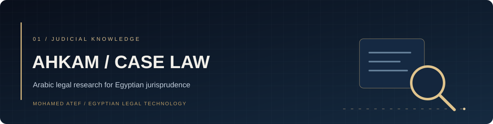
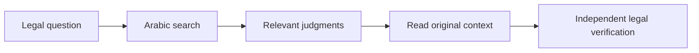

<div align="center">


# أحكام | Ahkam
**الموسوعة القضائية - أ / محمد عاطف**

[Explore Ahkam](https://ahkam.app/) · [Source and license](LICENSE) · [Developer](https://github.com/matef-hub)
</div>

## A clearer route from question to judgment

**Ahkam** is a research-oriented interface for Egyptian court judgments and legal principles, designed for Arabic legal text and practical case-law discovery. It brings search, readable excerpts and judgment navigation into one experience.

The product aims to keep **original judicial text** distinct from search-oriented normalization. Search results are research aids, not proof that a legal proposition remains controlling or that a judgment has been interpreted correctly.

## What this project explores

| Research task | Design objective |
|:--|:--|
| Discover judgments | Arabic-aware matching with relevant search results |
| Inspect context | Navigate to the underlying judgment and original text |
| Compare legal principles | Review results in their procedural and factual context |
| Work responsibly | Check authoritative sources, currency and completeness |



## Development

This repository contains a JavaScript application and associated tests and development tooling. It is not a distributable copy of the complete legal content platform.

```bash
npm run check
npm test
```

Some test commands require a Node.js version supporting `--experimental-sqlite`; see [package.json](package.json). Production resources, data and access control must be configured and independently reviewed before any deployment.

## Legal and security notes

- Legal findings must be independently checked against the complete judgment and current legislation.
- No README, front-end restriction or unlisted endpoint is a substitute for server-side authorization and data protection.
- This **public repository currently contains a [MIT license](LICENSE)**. Any future commercial licensing or restrictions require a separate legal and technical review; changing these words cannot withdraw earlier granted rights.
- Do not publish credentials, internal datasets, customer information or backup files.

**Maintained by [Mohamed Atef](https://github.com/matef-hub)** — Egyptian lawyer and legal-technology developer.
